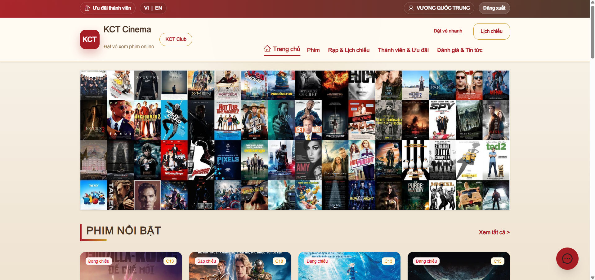
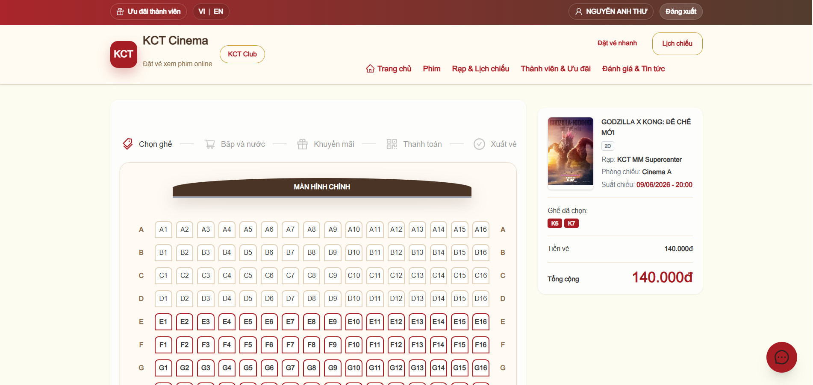
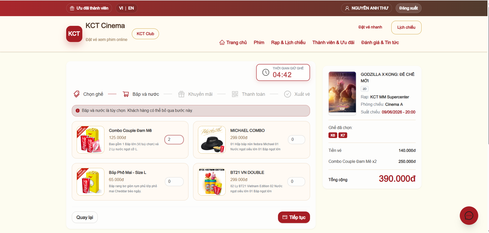
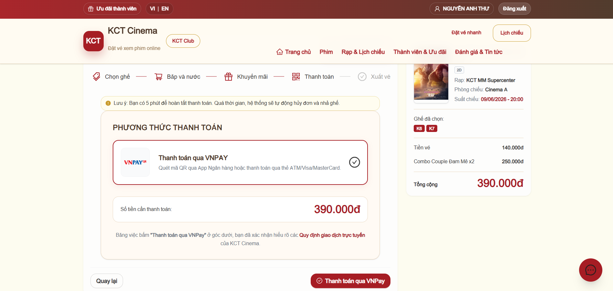
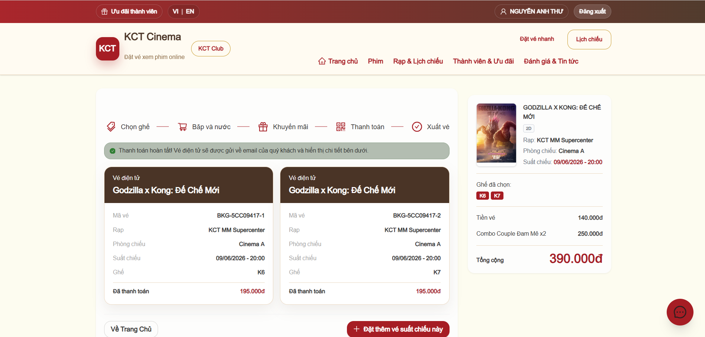
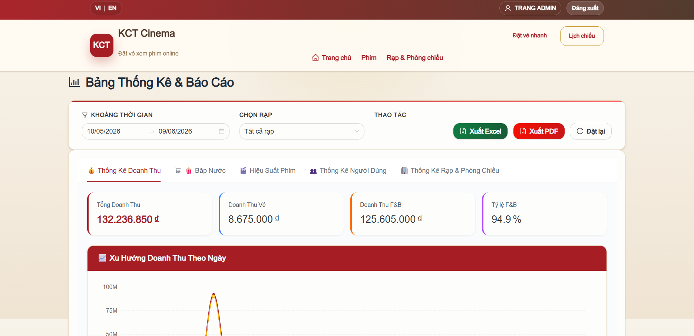
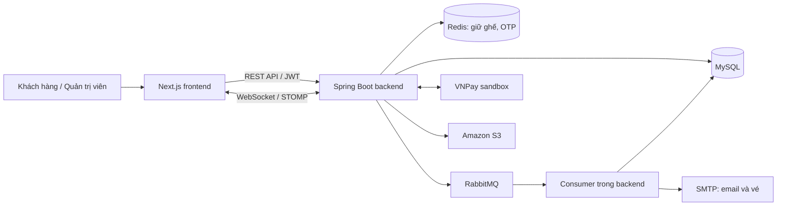

# KCT Cinema

**Website quản lý rạp chiếu phim & đặt vé trực tuyến**  
Đồ án PBL3 · Khoa Công nghệ thông tin · Trường Đại học Bách khoa, Đại học Đà Nẵng

Ứng dụng full-stack phục vụ hai nhóm người dùng: khách hàng tìm phim, chọn suất chiếu, giữ ghế và thanh toán; quản trị viên quản lý rạp, phim, lịch chiếu và theo dõi doanh thu. Repository chứa cả **Spring Boot backend** và **Next.js frontend**.

**[Xem giao diện](docs/SHOWCASE.md)** · **[Kiến trúc & mã nguồn](docs/ARCHITECTURE.md)** · **[Hướng dẫn chạy](docs/SETUP.md)** · **[Tải báo cáo PBL3](docs/report/BaoCaoPBL3.docx)**

> Ảnh giao diện được trích từ báo cáo đồ án, phản ánh phiên bản được ghi nhận trong báo cáo. Bạn có thể xem sản phẩm ngay trên GitHub mà không cần khởi động các dịch vụ cloud. Mã nguồn hiện tại có thể khác một số chi tiết giao diện.

## Trải nghiệm đặt vé

**Chọn phim & suất chiếu → chọn ghế → bắp nước → ưu đãi → VNPay → vé điện tử.**

<table>
  <tr>
    <td width="50%"> <strong>01 · Chọn ghế</strong> Xem sơ đồ phòng, chọn vị trí và giữ ghế trong thời gian đặt vé.</td>
    <td width="50%"> <strong>02 · Thêm bắp nước</strong> Chọn combo và xem tổng tiền trước khi thanh toán.</td>
  </tr>
  <tr>
    <td> <strong>03 · Thanh toán</strong> Áp dụng ưu đãi và chuyển sang cổng VNPay sandbox.</td>
    <td> <strong>04 · Nhận vé</strong> Xem vé sau giao dịch; backend hỗ trợ mã QR và gửi vé qua email.</td>
  </tr>
</table>

## Góc nhìn quản trị

Quản trị viên có các màn hình quản lý phim, suất chiếu, rạp/phòng/ghế, người dùng, bắp nước, khuyến mãi và tin tức; theo dõi doanh thu, hiệu quả phim và hỗ trợ khách hàng qua chat.

**[Xem thêm ảnh trang quản trị và từng bước đặt vé →](docs/SHOWCASE.md)**

## Chức năng chính

| Phân hệ | Chức năng có trong mã nguồn |
| --- | --- |
| Tài khoản | Đăng ký, xác thực OTP qua email, đăng nhập, đặt lại mật khẩu, phân quyền |
| Khám phá phim | Danh sách và chi tiết phim, lịch chiếu, tin tức, đánh giá |
| Đặt vé | Chọn suất chiếu và ghế, giữ ghế tạm thời, combo bắp nước, mã khuyến mãi |
| Thanh toán & vé | Tích hợp VNPay sandbox, xử lý kết quả giao dịch, vé điện tử và QR |
| Quản trị | Quản lý phim, lịch chiếu, rạp/phòng/ghế, người dùng và nội dung |
| Thống kê & hỗ trợ | Biểu đồ doanh thu, thống kê phim/bắp nước/rạp, chat qua WebSocket |

## Điểm kỹ thuật đáng xem

- **Giữ ghế có thời hạn:** Redis `setIfAbsent` với TTL và kiểm tra trạng thái ghế trong DB; Lua script chỉ giải phóng khóa thuộc đúng người giữ. Xem [SeatHoldService](backend/src/main/java/com/devteria/cinemaback_end/booking/service/SeatHoldService.java).
- **Phát hành vé bất đồng bộ:** RabbitMQ xử lý sự kiện sau thanh toán; consumer ghi nhận `eventId` đã xử lý và khóa bản ghi booking khi phát hành vé để xử lý sự kiện lặp. Xem [BookingPaidTicketIssuer](backend/src/main/java/com/devteria/cinemaback_end/booking/service/BookingPaidTicketIssuer.java).
- **Cập nhật trạng thái ghế:** WebSocket/STOMP truyền thay đổi tới giao diện. Xem [SeatNotificationService](backend/src/main/java/com/devteria/cinemaback_end/booking/service/SeatNotificationService.java).
- **Xác thực & phân quyền:** Spring Security, JWT và các luồng OTP/đặt lại mật khẩu. Xem [module user](backend/src/main/java/com/devteria/cinemaback_end/user).
- **Tổ chức theo nghiệp vụ:** các module `booking`, `movie`, `cinema`, `user`, `promotion`, `concession`, `article`, `chat` chia controller, service, repository, DTO và entity.

## Công nghệ

| Thành phần | Công nghệ |
| --- | --- |
| Backend | Java 25, Spring Boot 4.0.5, Spring Security, Spring Data JPA, Hibernate |
| Frontend | Next.js 16, React 19, TypeScript, Tailwind CSS 4, Ant Design, Recharts |
| Dữ liệu & xử lý nền | MySQL, Redis, RabbitMQ |
| Tích hợp | VNPay sandbox, SMTP, Amazon S3, WebSocket/STOMP, ZXing |
| Ánh xạ dữ liệu | Lombok, MapStruct |

Phiên bản công nghệ lấy từ [pom.xml](backend/pom.xml) và [package.json](frontend/datveonline/package.json) hiện tại.

## Kiến trúc tổng quan

Các consumer chạy trong ứng dụng backend; sơ đồ tách chúng ra để thể hiện luồng xử lý, không mô tả một hệ thống microservices.

## Chạy dự án

Cần JDK 25, Maven, Node.js tương thích Next.js 16 và các dịch vụ MySQL, Redis, RabbitMQ. Cấu hình thêm SMTP, VNPay sandbox và S3 theo chức năng sử dụng.

1. Tạo `backend/.env.properties` theo [hướng dẫn cấu hình](docs/SETUP.md).
2. Trong `backend`, chạy `./mvnw spring-boot:run` (Windows: `.\mvnw.cmd spring-boot:run`).
3. Trong `frontend/datveonline`, chạy `npm ci`, cấu hình `.env.local`, sau đó `npm run dev`.
4. Mở `http://localhost:3000`; API mặc định: `http://localhost:9090/cinema`.

Xem [SETUP.md](docs/SETUP.md) để biết đầy đủ biến môi trường, lưu ý Redis SSL, DB và xử lý lỗi khởi động. Repo chưa kèm bản dump dữ liệu phim/lịch chiếu; database mới cần được nhập dữ liệu để trải nghiệm luồng đặt vé.

## Nhóm thực hiện

Phân công dưới đây theo bảng nhiệm vụ trong báo cáo PBL3; đây là đồ án nhóm.

| Thành viên | Đóng góp theo báo cáo |
| --- | --- |
| **Đinh Huỳnh Nguyên Khang** | Xây dựng backend; hỗ trợ giao diện và thiết kế chức năng; kiểm thử, sửa lỗi và hỗ trợ báo cáo |
| **Vương Quốc Trung** | Phân tích yêu cầu; thiết kế chức năng, UML và cơ sở dữ liệu; hỗ trợ backend; viết báo cáo |
| **Nguyễn Mạnh Cường** | Xác định đề tài và yêu cầu; thiết kế, lập trình giao diện; sửa lỗi và hỗ trợ báo cáo |

## Tài liệu & phạm vi

- [Báo cáo PBL3 bản gốc (.docx)](docs/report/BaoCaoPBL3.docx): phân tích yêu cầu, phân công, UML, thiết kế dữ liệu, chức năng và giao diện.
- [Thư viện giao diện](docs/SHOWCASE.md): ảnh lớn kèm mô tả theo từng nghiệp vụ.
- [Kiến trúc & sơ đồ dữ liệu](docs/ARCHITECTURE.md): điểm bắt đầu để đọc code.
- [Thiết lập môi trường](docs/SETUP.md): hướng dẫn chạy lại dự án.

Đây là sản phẩm học tập. Tích hợp thanh toán được giới thiệu ở chế độ sandbox; tài liệu này không khẳng định dịch vụ demo/cloud hiện còn hoạt động hay hệ thống đã sẵn sàng vận hành thương mại. Hình ảnh phim và các nhãn hiệu xuất hiện trong giao diện được dùng để minh họa đồ án; dự án không phải website chính thức của các thương hiệu đó.
