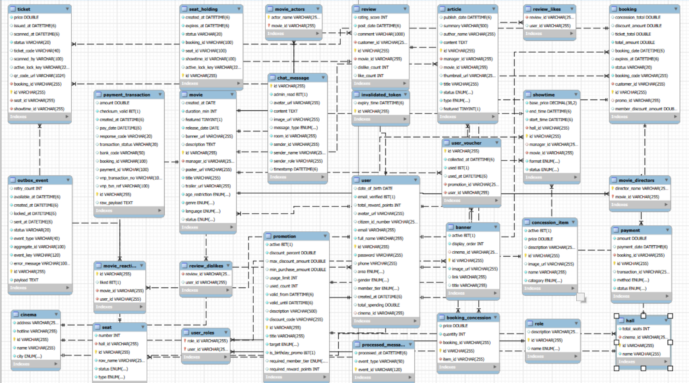

# Kiến trúc và hướng đọc mã nguồn

[← Về trang giới thiệu](../README.md)

## Cấu trúc repository

```text
Cinema-back_end/
├── backend/
│   ├── src/main/java/com/devteria/cinemaback_end/
│   │   ├── article/         # Tin tức
│   │   ├── booking/         # Giữ ghế, đơn đặt vé, thanh toán, vé
│   │   ├── chat/            # Hỗ trợ trực tuyến
│   │   ├── cinema/          # Rạp, phòng, ghế
│   │   ├── concession/      # Bắp nước
│   │   ├── configuration/   # Security, Redis, RabbitMQ...
│   │   ├── movie/           # Phim, suất chiếu, đánh giá
│   │   ├── promotion/       # Khuyến mãi
│   │   └── user/            # Tài khoản và xác thực
│   └── src/main/resources/application.yml
├── frontend/datveonline/app/
│   ├── admin/              # Trang quản trị
│   ├── components/         # Thành phần giao diện
│   ├── dat-ve/             # Luồng đặt vé
│   ├── phim/               # Danh sách và chi tiết phim
│   └── lib/                # Gọi API và tiện ích
└── docs/                   # Giao diện, hướng dẫn, báo cáo
```

## Luồng đặt vé

1. Frontend tra cứu phim, cơ sở rạp và suất chiếu qua API.
2. Khi người dùng giữ ghế, backend dùng khóa Redis có TTL, kiểm tra ghế trong DB và thông báo trạng thái qua WebSocket.
3. Đơn đặt vé ghi nhận vé, combo và khuyến mãi; backend tạo URL thanh toán VNPay.
4. Backend nhận và xử lý kết quả thanh toán; sự kiện thanh toán được đưa vào luồng xử lý nền.
5. Consumer phát hành vé, tạo QR và cập nhật trạng thái. `BookingPaidTicketIssuer` dùng bảng ghi sự kiện đã xử lý để nhận diện sự kiện trùng.
6. Sau commit, backend giải phóng khóa giữ ghế, thông báo trạng thái và thực hiện gửi email vé. Lỗi gửi email được ghi log; không đồng nghĩa giao dịch phát hành vé bị rollback.

Đây là mô tả thiết kế theo mã nguồn, không phải kết quả kiểm thử tải hoặc cam kết không xảy ra lỗi đồng thời.

## Điểm bắt đầu cho người review

| Nội dung | Mã nguồn |
| --- | --- |
| Khóa và giải phóng ghế | [SeatHoldService](../backend/src/main/java/com/devteria/cinemaback_end/booking/service/SeatHoldService.java) |
| Đơn đặt vé | [BookingService](../backend/src/main/java/com/devteria/cinemaback_end/booking/service/BookingService.java) |
| API thanh toán | [PaymentController](../backend/src/main/java/com/devteria/cinemaback_end/booking/controller/PaymentController.java) |
| Xử lý VNPay | [VnPayService](../backend/src/main/java/com/devteria/cinemaback_end/booking/service/VnPayService.java) |
| Consumer phát hành vé | [BookingPaidTicketIssuer](../backend/src/main/java/com/devteria/cinemaback_end/booking/service/BookingPaidTicketIssuer.java) |
| Queue, retry và dead-letter | [RabbitMQConfig](../backend/src/main/java/com/devteria/cinemaback_end/configuration/RabbitMQConfig.java) |
| Giao diện chọn ghế | [seat-selection-client.tsx](../frontend/datveonline/app/components/seat-selection-client.tsx) |
| API client | [cinema-api.ts](../frontend/datveonline/app/lib/cinema-api.ts) |

## Thiết kế dữ liệu trong báo cáo



Sơ đồ phản ánh thời điểm viết báo cáo. Các entity trong `backend/src/main/java` là nơi đối chiếu cấu trúc mã nguồn hiện tại; có thể có thêm bảng phục vụ các cơ chế xử lý nền.

## Kiểm thử và giới hạn

Repo có [thư mục test backend](../backend/src/test) và cấu hình H2 cho test. Việc có test không đồng nghĩa mọi nghiệp vụ đã có độ bao phủ đầy đủ. Lần bổ sung tài liệu này không chạy lại ứng dụng, thanh toán hay toàn bộ test suite.

Các hướng phát triển phù hợp: bổ sung kiểm thử đồng thời giữ ghế, giao dịch và sự kiện lặp; migration DB có phiên bản; dữ liệu mẫu có thể tái tạo; môi trường demo độc lập và CI kiểm thử tự động.
