# Khám phá giao diện KCT Cinema

[← Về trang giới thiệu](../README.md) · [Tải báo cáo gốc](report/BaoCaoPBL3.docx)

Các ảnh dưới đây được trích nguyên trạng từ báo cáo PBL3, không phải ảnh chụp một phiên chạy mới. Dữ liệu, tổng tiền và doanh thu trong ảnh là nội dung của bản trình bày đồ án, không phải số liệu kinh doanh được xác minh. Nhấn vào ảnh để xem kích thước gốc trên GitHub.

## 1. Tìm phim và lịch chiếu

Trang chủ giới thiệu phim và các khu vực chức năng của website.

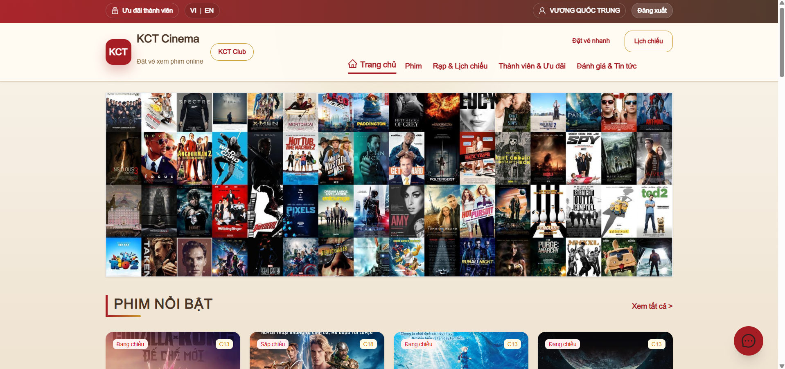

Người dùng chọn ngày, cơ sở rạp và giờ chiếu trước khi đặt vé.

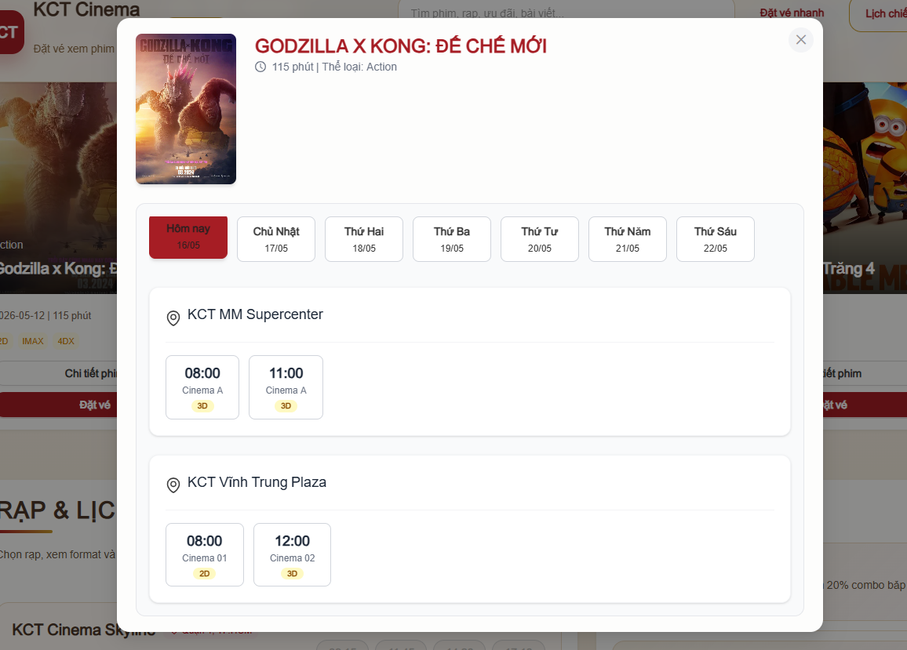

## 2. Đăng nhập

Giao diện đăng nhập để tiếp tục các thao tác cần tài khoản. Backend có các luồng đăng ký, xác thực email và đặt lại mật khẩu.

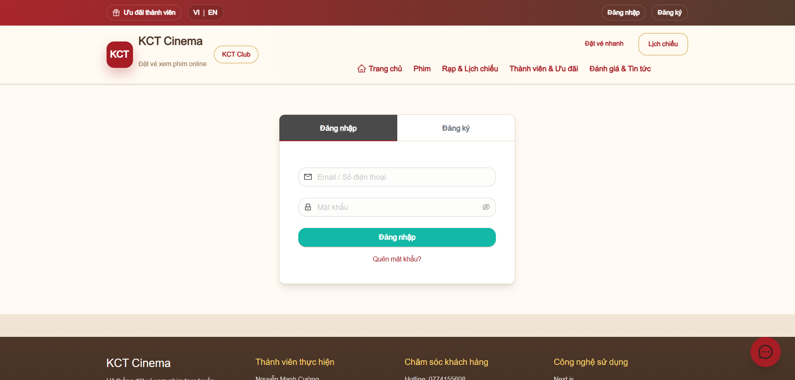

## 3. Chọn ghế và bắp nước

Sơ đồ phòng thể hiện các vị trí ghế; phần bên cạnh hiển thị suất chiếu và thông tin đơn.

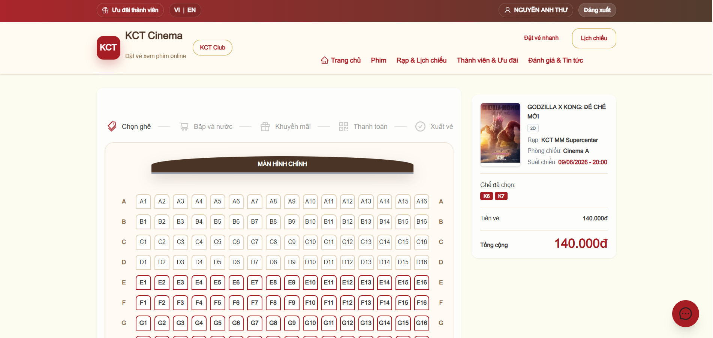

Chọn combo bắp nước trước khi chuyển tới bước ưu đãi và thanh toán.

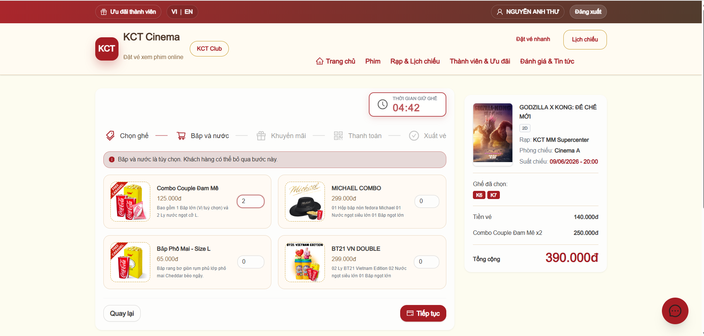

## 4. Ưu đãi và thanh toán

Người dùng nhập hoặc chọn mã khuyến mãi, xem lại đơn và chọn VNPay.

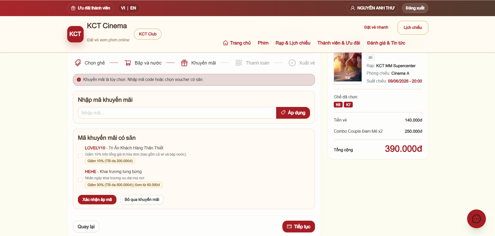

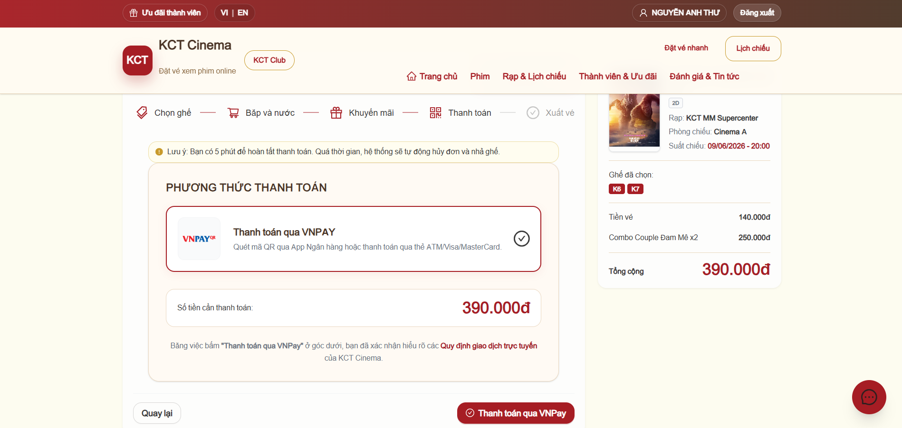

Màn hình cổng thanh toán trong báo cáo sử dụng môi trường VNPay thử nghiệm.

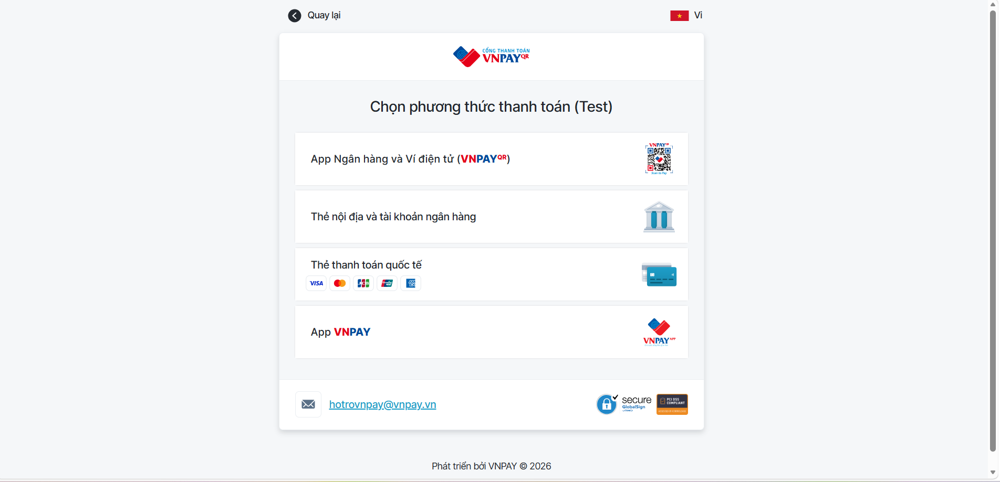

## 5. Nhận vé

Màn hình xuất vé sau thanh toán. Mã nguồn backend còn có chức năng tạo QR và gửi vé qua email.

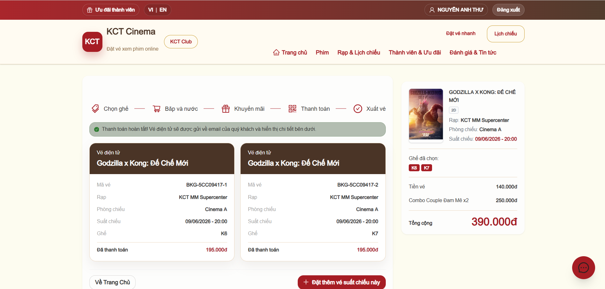

## 6. Quản trị nội dung và lịch chiếu

Trang tổng quan cung cấp lối vào các phân hệ quản lý.

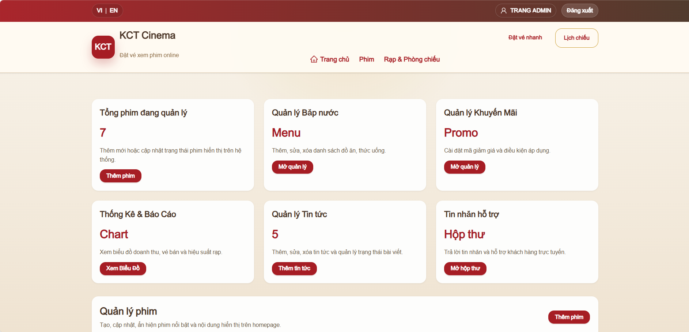

Danh sách phim với trạng thái công chiếu và thao tác cập nhật.

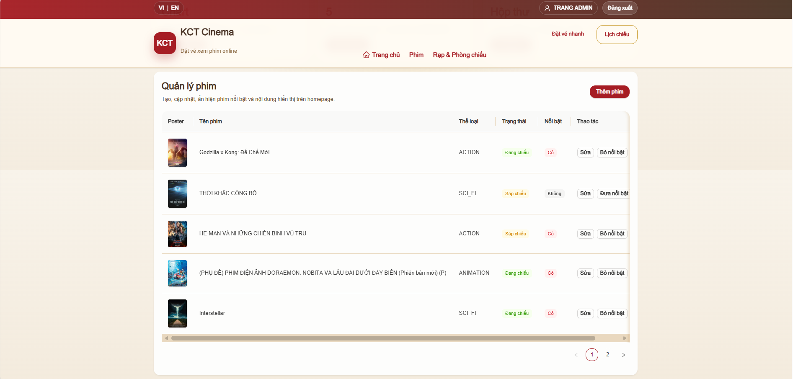

Quản lý suất chiếu theo ngày và cơ sở rạp.

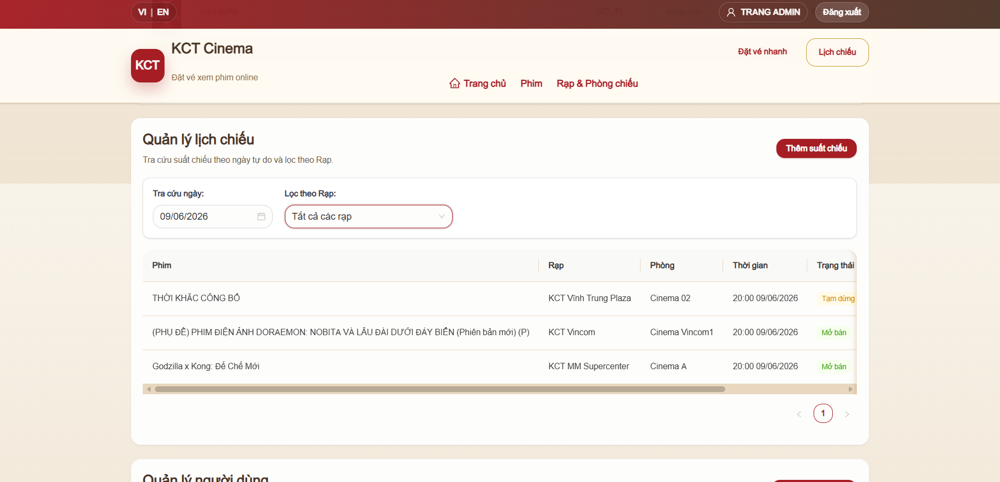

## 7. Quản lý cơ sở và sơ đồ ghế

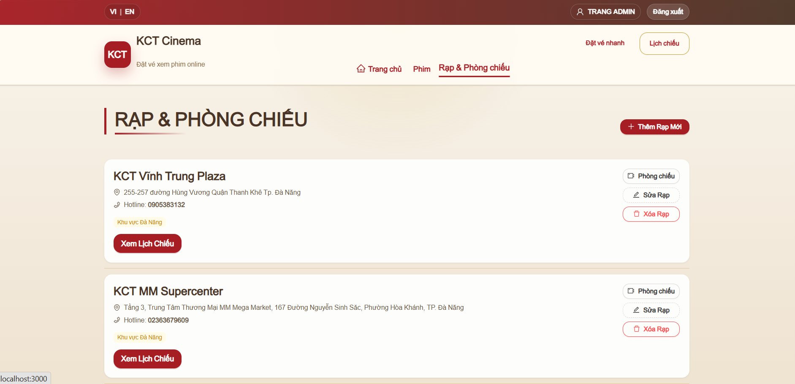

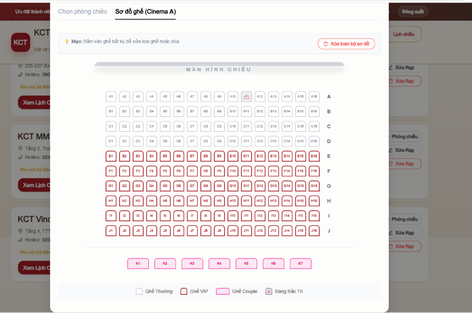

## 8. Thống kê doanh thu

Bảng tổng hợp doanh thu, bộ lọc thời gian và các khu vực phân tích.

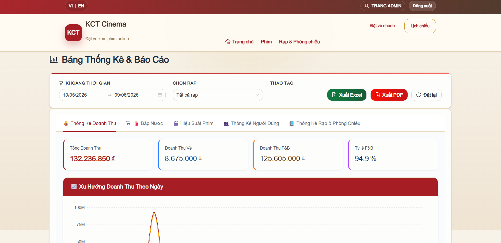

Biểu đồ theo ngày, tuần và phương thức thanh toán.

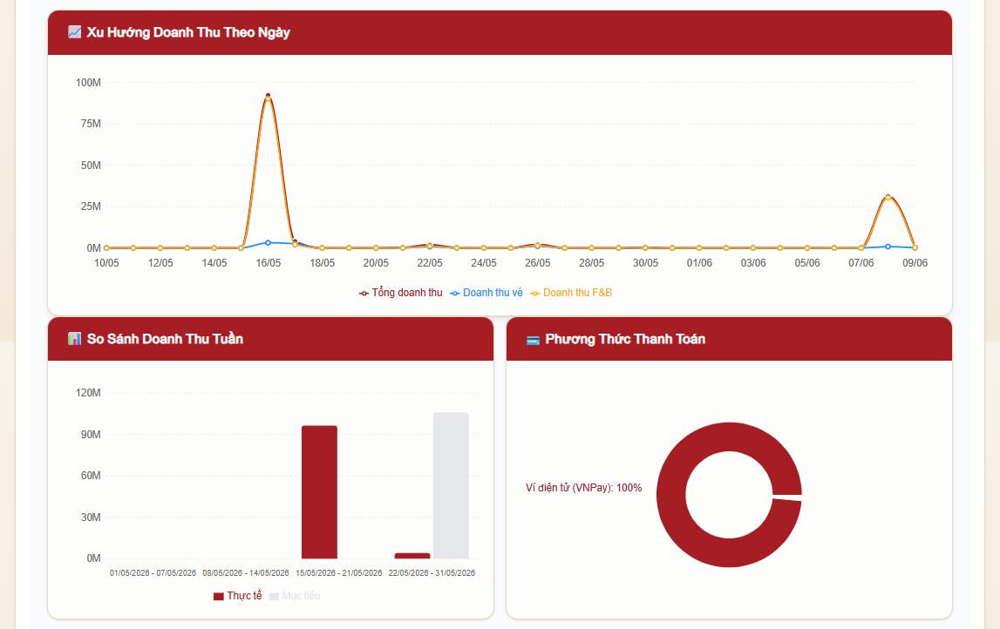

## Nguồn ảnh

Ảnh được lấy từ thư mục media bên trong [BaoCaoPBL3.docx](report/BaoCaoPBL3.docx). Tên ảnh được đổi để dễ quản lý; nội dung ảnh giữ nguyên.

| File trong tài liệu | File trình bày |
| --- | --- |
| image20.png | home.png |
| image24.png | login.png |
| image27.png | showtimes.png |
| image30.png | seat-selection.png |
| image31.png | concessions.png |
| image32.png | promotions.png |
| image33.png | checkout.png |
| image34.png | vnpay.png |
| image36.png | tickets.png |
| image37.png | admin-dashboard.png |
| image38.png | admin-movies.png |
| image39.png | admin-showtimes.png |
| image49.png | admin-cinemas.png |
| image52.png | admin-seats.png |
| image55.png | statistics.png |
| image56.png | revenue.png |
| image19.png | database.png (trong trang kiến trúc) |
